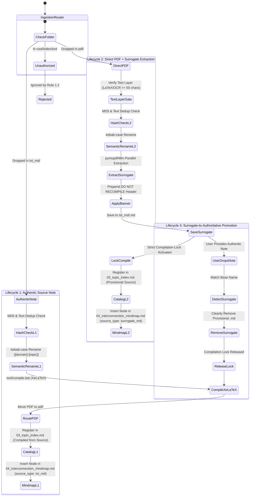

# Repository Management Skill

This skill defines the operational laws, ingestion lifecycles, directory governance, and automated pipeline rules for managing the **Study Knowledge Hub** (`D:\STUDY`). Every agent operating in this repository must strictly adhere to these instructions alongside the `karpathy-guidelines` skill.

---

## 1. Fundamental Architecture & Scope Boundaries

### 1.1 Directory Hierarchy & Roles
```text
D:\STUDY\
├── txt_md/     <-- INGESTION & TEXT: Authentic source notes & provisional search surrogates ONLY
├── pdf/        <-- PUBLISHED OUTPUT: Final compiled XeLaTeX PDFs and verified direct PDF imports
├── index/      <-- CONTROL PLANE: Internal AI-only machine-readable indexation & relational graph
├── tool/       <-- COMPILER ENGINE: Pandoc + XeLaTeX publishing toolchain (STRICTLY IMMUTABLE)
├── manage.bat  <-- AUTOMATION RUNNER: Headless Windows batch wrapper
└── manage.py   <-- AUTOMATION ENGINE: Mechanical execution, deduplication & index reconciler
```

### 1.2 Immutable Boundaries
1. **The `tool/` Directory is Read-Only & Immutable**:
   - Never edit, modify, append, or delete any file in `D:\STUDY\tool\` (`compile.bat`, `setup.bat`, Lua filters in `config/`, `custom.tex`, or documentation).
   - Treat `tool/` as a frozen external compiler engine.
2. **Strict Ingestion Source Isolation**:
   - Only files placed inside `D:\STUDY\txt_md/` are eligible for note compilation.
   - Only pre-compiled PDFs placed inside `D:\STUDY\pdf/` are eligible for direct PDF ingestion.
   - If a `.txt`, `.md`, or `.pdf` file is found outside these two folders (e.g., in `root`, `index/`, or `tool/`), **DO NOT index it, DO NOT rename it, and DO NOT compile it**.
3. **Non-Destructive Source Content Policy**:
   - Never modify, rewrite, summarize, or alter the substantive conceptual text of notes in `D:\STUDY\txt_md/`.
   - Original explanations, mathematical derivations, scientific statements, arguments, and factual data must remain untouched.
   - **Exception**: Syntax-only fixes (closing unclosed code fences, escaping invalid LaTeX tokens) are permitted ONLY when compilation fails with a fatal error or upon explicit user request.
4. **AI-Only Control Plane Mandate**:
   - The entire `index/` directory is an internal AI control plane designed for machine parsing, retrieval, and relational reasoning (not human visualization).
   - Do NOT insert visual ASCII diagrams or human charts into `03_topic_index.md` or `04_interconnection_mindmap.md`. When the user asks for relationships or summaries, query the control plane and respond in conversational text.

---

## 2. Three-Tier Ingestion State Machine



### 2.1 Lifecycle 1: Authentic Source Notes (`txt_md/` $\to$ `pdf/`)
1. **Analyze**: AI reads content to determine Domain, Core Concepts, Prerequisites, and dense Summary.
2. **Deduplicate**: Run MD5 and normalized body text check against existing notes in `txt_md/`. If identical, halt ingestion.
3. **Rename**: Rename file to semantic identifier in `kebab-case` (`[domain]-[topic].[ext]`).
4. **Compile**: Invoke `tool/compile.bat` non-interactively using piped stdin (`(echo Y & echo.) | compile.bat`).
5. **Route**: Move compiled PDF from `txt_md/` to `pdf/` with matching base name.
6. **Register**:
   - `03_topic_index.md`: Status `Compiled from Source`.
   - `04_interconnection_mindmap.md`: Node `source_type: txt_md`, `source_note: <name>.<ext>`.

### 2.2 Lifecycle 2: Direct PDF Imports & Provisional Surrogates (`pdf/` $\to$ `txt_md/`)
1. **Text Layer Gate**: Verify extractable text layer ($\ge 50$ characters). Reject pure bitmap/scanned PDFs without OCR.
2. **Deduplicate**: Compare MD5 and extracted text against existing PDFs in `pdf/`.
3. **Rename**: Rename to semantic identifier in `kebab-case`.
4. **Surrogate Extraction (`pymupdf4llm`)**:
   - Extract structured Markdown to `txt_md/<basename>.md`.
   - Prepend immutable safety banner:
     ```markdown
     <!-- ===================================================================== -->
     <!-- AUTO-GENERATED SURROGATE SOURCE (FOR SEARCH & CATALOGING ONLY)       -->
     <!-- Source PDF: <basename>.pdf                                            -->
     <!-- Status: PROVISIONAL SURROGATE (DO NOT RECOMPILE)                      -->
     <!-- Purpose: Instant full-text search, AI context retrieval & knowledge graph mapping. -->
     <!-- Note: Will be automatically replaced when an authentic manual source note is provided. -->
     <!-- ===================================================================== -->
     ```
5. **Strict Compilation Lock**: `manage.py` and compilation drivers must halt with exit code 1 if asked to compile a surrogate note.
6. **Register**:
   - `03_topic_index.md`: Status `Provisional Source (Auto-extracted)`.
   - `04_interconnection_mindmap.md`: Node `source_type: surrogate_md`, `source_note: <basename>.md`.

### 2.3 Lifecycle 3: Surrogate-to-Authoritative Promotion
1. **Detect**: When user drops an authentic `.txt` or `.md` note matching an existing surrogate base name:
2. **Remove Surrogate**: Safely delete the provisional `<basename>.md` surrogate.
3. **Ingest Authentic Note**: Ingest, rename, and release the compilation lock.
4. **Compile Definitive PDF**: Compile via `tool/compile.bat` and overwrite `pdf/<basename>.pdf`.
5. **Upgrade Status**:
   - In `03_topic_index.md`: Upgrade status to `Compiled from Source`.
   - In `04_interconnection_mindmap.md`: Upgrade node to `source_type: txt_md`.

---

## 3. Automation Engine Boundaries (`manage.py` / `manage.bat`)

### ✅ Permitted Engine Capabilities:
1. **Mechanical File Operations**: Renaming, moving compiled PDFs to `pdf/`, cleaning provisional surrogates upon replacement.
2. **Headless Compilation Driver**: Running `tool/compile.bat` non-interactively with piped stdin.
3. **Compilation Interlock**: Rejecting compilation for any file containing `DO NOT RECOMPILE` / `AUTO-GENERATED SURROGATE`.
4. **Atomic Control Plane Updates**: Appending/updating rows and detail blocks in `03_topic_index.md` and nodes/edges in `04_interconnection_mindmap.md`.
5. **Deduplication Auditing**:
   - `manage.bat scan`: Verifying unindexed files and counting authentic source notes vs provisional surrogates.
   - `manage.bat audit-duplicates`: Checking whole-repository MD5 hashes and normalized body text similarity.
   - `manage.bat remove-doc`: Consolidating and removing duplicate documents atomically.
6. **Zero-Permission Execution**: Staging instructions in `.pending.json` and invoking static `cmd /c "D:\STUDY\manage.bat process"`.

### ❌ Strictly Prohibited Engine Actions:
1. **NEVER modify or touch `tool/`**.
2. **NEVER alter substantive text inside `txt_md/`**.
3. **NEVER use regex/heuristics to invent titles or topic relationships** (the AI must always read and analyze first).
4. **NEVER touch files outside `txt_md/` and `pdf/`**.
5. **NEVER USE `manage.py` FOR SEARCHING OR USER QUERIES**.

---

## 4. Search & Retrieval Execution Mandate

When the user asks to search, find topics, explore conceptual connections, or review notes:
1. **`manage.py` MUST NOT BE USED**: Searching is purely an AI reasoning and reading task.
2. **Three-Stage Search Protocol**:
   * **Stage 1 (Control Plane Lookup)**: Inspect `03_topic_index.md` and `04_interconnection_mindmap.md` to identify candidate `DOC-XXX` IDs, domains, prerequisites, and relational triples.
   * **Stage 2 (Full-Text Scan across `txt_md/`)**: Search across the plaintext `.md`/`.txt` files in `txt_md/` (which now covers 100% of the repository thanks to surrogate extraction).
   * **Stage 3 (Deep Read & Synthesis)**: Use `read_file` on focal notes to inspect exact equations, proofs, and definitions. Deliver a synthesized answer with KaTeX math and clickable links to both source note (`[note.md](file:///D:/STUDY/txt_md/note.md)`) and published PDF (`[note.pdf](file:///D:/STUDY/pdf/note.pdf)`).

---

## 5. Proactive Maintenance & Git Standards

1. **Invocation Scan**: Run `manage.bat scan` proactively on every new turn/session to detect any filesystem changes.
2. **Zero Redundancy**: If `manage.bat audit-duplicates` detects identical content, consolidate into a single document ID immediately.
3. **Git Hygiene**:
   * `.gitignore` must ignore `pdf/*` (except `pdf/.gitkeep`). Binary PDFs are never pushed.
   * All note text in `txt_md/` (authentic + surrogate) and index files in `index/` are tracked and pushed.
   * Never commit `.pending.json`, `tool/md2pdf_cache/`, `__pycache__/`, or scratch files.
4. **Audit Checklist**: After any workflow or engine modification, audit and synchronize all 7 core documents:
   * `README.md`
   * `index/README.md`
   * `index/01_tool_usage.md`
   * `index/02_directory_management.md`
   * `index/03_topic_index.md`
   * `index/04_interconnection_mindmap.md`
   * `index/05_contributing_and_versioning.md`
