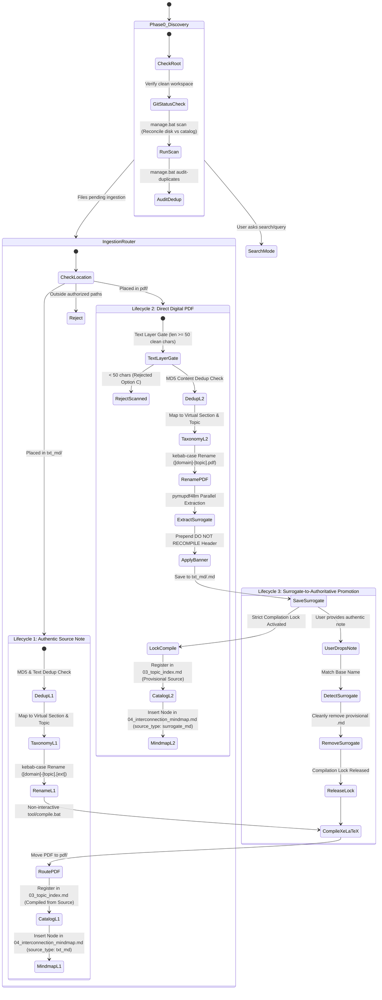

# Repository Management Skill (Universal & Portable Edition)

This skill defines the operational laws, lifecycle state machines, directory governance, and automated pipeline rules for managing an automated **Study Knowledge Hub & Notes Management Repository**.

Any AI agent entering this workspace—whether pre-existing or initialized fresh in a brand-new directory on any machine—must execute strictly under this specification in coordination with the `karpathy-guidelines` skill.

---

## 1. Portable Workspace Architecture & Dynamic Root Resolution

### 1.1 Dynamic Root Resolution
The workspace root is defined dynamically as `<WORKSPACE_ROOT>` (the directory where `manage.py`, `manage.bat`, and `README.md` reside). **NEVER hardcode absolute machine paths** (such as specific drive letters `C:`, `D:`, or user profiles). All operational paths are resolved relative to `<WORKSPACE_ROOT>`.

### 1.2 Universal Directory Roles
```text
<WORKSPACE_ROOT>/
├── txt_md/     <-- INGESTION & TEXT: Authentic source notes & provisional search surrogates (both .md and .txt supported)
├── pdf/        <-- PUBLISHED OUTPUT: Final compiled XeLaTeX PDFs and verified digital PDF imports
├── scrap/      <-- UNIVERSAL DROPZONE & QUARANTINE: Dropzone for incoming notes (both .md and .txt) and PDFs; isolates non-text PDFs
├── index/      <-- CONTROL PLANE: Internal AI-only machine-readable indexation & relational graph
│   ├── README.md              <-- Master control plane index and quick entry
│   ├── 00_syllabus_taxonomy.md <-- Formal curriculum breakdown, sub-topic inventory & coverage matrix
│   ├── 01_tool_usage.md       <-- Compiler usage, execution flags & bypass commands
│   ├── 02_directory_management.md <-- Governance, naming SOP, deduplication & lifecycle rules
│   ├── 03_topic_index.md      <-- Master document catalog, coverage dashboard & detail blocks
│   ├── 04_interconnection_mindmap.md <-- Semantic YAML knowledge graph & relational triples
│   └── 05_contributing_and_versioning.md <-- Architecture, line-change budget & cumulative ledger
├── md_skill/   <-- REUSABLE SKILLS VAULT: Portable skill blueprints & automated installer driver
│   ├── README.md              <-- Skill deployment instructions
│   ├── install.bat            <-- 1-click deployment driver copying blueprints to .agent/skills/
│   ├── SKILL.md               <-- Karpathy Guidelines skill blueprint
│   └── management_skill.md    <-- Repository Management skill blueprint (authoritative source)
├── tool/       <-- COMPILER ENGINE: Pandoc + XeLaTeX publishing toolchain (STRICTLY IMMUTABLE)
│   ├── compile.bat            <-- Windows compilation driver
│   ├── setup.bat              <-- Environment verification script
│   ├── config/                <-- LaTeX templates, Lua filters, and normalizers
│   └── documentation/         <-- Architecture and rendering specifications
├── manage.bat  <-- One-click automation batch driver (scan, process, audit-duplicates, coverage)
├── manage.py   <-- Master automation engine (mechanical operations, deduplication & catalog reconciler)
└── README.md   <-- User manual and quick-start guide
```

### 1.3 Immutable Boundaries & Core Safeguards
1. **The `tool/` Directory is Read-Only, Strictly Immutable & Non-Recreatable**:
   - Never edit, modify, overwrite, append, or delete ANY file in `tool/` (`compile.bat`, `setup.bat`, Lua filters in `config/`, `custom.tex`, or documentation). Treat `tool/` as an external, frozen compiler engine.
   - **Missing Tool Invariant**: If the `tool/` folder does not exist in the workspace, **DO NOT attempt to remake or reconstruct it manually**. Instead, acquire the official tool automatically from its public repository:
     ```cmd
     git clone https://github.com/Thunderock7777/ai-ready-markdown-to-pdf tool
     ```
     *(Or if inside an existing Git repository with submodules: `git submodule update --init --recursive`).*
2. **Strict Ingestion Source Isolation**:
   - Only files placed inside `txt_md/` are eligible for note compilation.
   - Only pre-compiled PDFs placed inside `pdf/` are eligible for direct PDF ingestion.
   - Any `.txt`, `.md`, or `.pdf` file found outside these two folders (e.g. in root, `index/`, `tool/`) is **strictly ignored**—do NOT index, rename, or compile it.
3. **Non-Destructive Source Content Policy**:
   - Never alter, rewrite, edit, or summarize substantive conceptual content in `txt_md/`. Original equations, explanations, derivations, and statements must remain untouched.
   - *Exception*: Syntax-only fixes (closing broken fences, escaping invalid LaTeX tokens) are permitted ONLY when compilation fails with a fatal error or upon explicit user request.
4. **AI-Only Control Plane Mandate**:
   - The entire `index/` directory is an internal AI control plane designed for machine parsing, retrieval, and relational reasoning (not human visual presentation). Do not insert human diagrams or decorative charts into `03_topic_index.md` or `04_interconnection_mindmap.md`. When the user asks for relationships or summaries, query the control plane and respond in conversational markdown.
5. **Search Isolation Mandate**:
   - `manage.py` is a mechanical executor, NOT a search engine. When the user asks to search, find topics, or trace relationships, **`manage.py` must NEVER be used**. The AI agent performs all searching directly using native reading tools.
6. **Fundamental Architectural Prerequisite: Digital Text-Layer Mandate (Option C Gate)**:
   - The entire surrogate extraction pipeline (`pymupdf4llm`), full-text search across `txt_md/`, and relational mindmap strictly operate under the foundational requirement that **all imported PDFs must possess a clean, extractable digital text layer** (LaTeX-typeset or digital print).
   - Scanned image PDFs, photocopies, handwritten notebook pictures converted to PDF, camera snapshots, and files with missing or corrupted font encodings (`< 50` characters of extractable text) are **strictly prohibited from entering `pdf/`**.
   - If a non-text PDF is provided, the manager automatically quarantines it in `scrap/` (where it is preserved indefinitely and never deleted). To process its academic content, users must author an authentic text/markdown note in `txt_md/` (Lifecycle 1) to be compiled cleanly by XeLaTeX.
7. **AI Cognitive Primacy & Surgical Token-Conservation Invariant**:
   - The AI agent is the sole brain and cognitive engine of the entire repository workflow. Mechanical tools (`manage.bat`, `manage.py`, `tool/compile.bat`) are non-cognitive executors for deterministic I/O, hash calculation, Pandoc compilation, and catalog updates.
   - Token efficiency must never be pursued by offloading semantic reasoning to rigid scripts. Instead, the AI agent must enforce the 5 Token-Conservation Laws (macro-to-micro queries, line-sliced reads, relational mindmap traversal, and CPU-local scratch aggregation).
8. **Missing Syllabus Protocol (Ask-First with Autonomous AI Fallback)**:
   - If `index/00_syllabus_taxonomy.md` (or `index/syllabus.txt`) is absent in the workspace, the AI must first ask the user to provide their syllabus or curriculum specification (by pasting text or dropping a syllabus document into `scrap/` or `index/`).
   - If the user does not provide one or instructs the agent to proceed without one, the AI must immediately use its own internal academic reasoning and cognitive domain knowledge to synthesize an authoritative curriculum breakdown (`SEC-01` to `SEC-XX`), generate `index/00_syllabus_taxonomy.md`, and proceed without blocking.

### 1.4 Universal Dropzone, File Sweeper & Quarantine Architecture (`scrap/`)
1. **Universal User Dropzone**:
   - The `scrap/` folder serves as a frictionless entry point. The user may paste any mixed collection of `.txt`, `.md`, or `.pdf` files directly into `scrap/` (or into workspace root) without worrying about folder conventions.
2. **Automated Misplaced File Sweeping (`manage.bat sweep` / `python manage.py sweep`)**:
   - When executed, the manager scans `scrap/`, workspace root, `index/`, `txt_md/`, and `pdf/`:
     - Text/Markdown notes (`.txt`, `.md`) are moved to their authoritative home in `txt_md/`.
     - Valid digital PDFs ($\ge 50$ clean characters) are moved to `pdf/`.
     - PDFs lacking extractable digital text ($< 50$ characters) are quarantined in `scrap/`.
3. **Quarantine Safety Policy (Zero Destruction)**:
   - Scanned, handwritten, or image-only PDFs quarantined in `scrap/` are preserved indefinitely.
   - The system **will never delete files in `scrap/` unless explicitly instructed by the user**.
4. **Dual Format Invariant (Both `.md` and `.txt` Supported)**:
   - Note files inside `txt_md/` and `scrap/` can freely be **both Markdown (`.md`) or raw plaintext (`.txt`)**.
   - Both formats are treated as first-class citizens throughout the entire pipeline.
   - The original extension (`.md` or `.txt`) is strictly preserved during semantic renaming and cataloging. Pandoc and Lua normalizers compile both seamlessly into XeLaTeX PDFs.

---

## 2. Systematic Order of Operations: The Complete Lifecycle

When operating in this repository—whether entering a fresh turn or processing incoming documents—the AI agent must follow this exact sequential lifecycle:



### Phase 0: Discovery & Onboarding Protocol (On Session Startup)
Before touching any files or executing commands:
1. **Locate Workspace Root**: Identify the directory containing `manage.py` and `manage.bat`.
2. **Inspect Git Status**: Run `git status` to verify clean state, check for uncommitted changes or untracked user inputs.
3. **Verify Prerequisites**: Confirm that Python 3.10+, Pandoc, and XeLaTeX (`xelatex`) are accessible.
4. **Proactive Repository Audit (`manage.bat scan` / `python manage.py scan`)**:
   - Reconciles physical files in `txt_md/` and `pdf/` against `index/03_topic_index.md`.
   - Counts authentic source notes vs provisional surrogates and flags any unindexed files.
5. **Deduplication Audit (`manage.bat audit-duplicates`)**:
   - Verifies zero duplicate content hashes or identical body texts exist across the library.

---

### Phase 1: Ingestion Lifecycles & State Machine

#### Lifecycle 1: Processing Authentic Source Notes (`txt_md/` -> `pdf/`)
1. **Analyze Content**: Read the note to determine Domain, Core Concepts, Prerequisites, and dense Summary.
2. **Deduplication Check**: Compare MD5 hash and normalized body text against all files in `txt_md/`. If identical, halt and inform user.
3. **Taxonomy Classification**: Map document to its formal curriculum section (`SEC-XX`) and sub-topic unit based on `index/00_syllabus_taxonomy.md`.
4. **Semantic Renaming**: Rename to `kebab-case` (`[domain]-[topic].[ext]`). Notes can be **either `.md` or `.txt`**, and the original extension is strictly preserved throughout compilation.
5. **Headless Compilation**:
   - Run via `(echo Y & echo.) | tool\compile.bat txt_md\<filename>.md` (or through `manage.bat process`) with `BypassSandbox: true`.
   - Verify that `<filename>.pdf` was successfully created.
6. **PDF Routing**: Move `<filename>.pdf` from `txt_md/` to `pdf/`.
7. **Control Plane Registration**:
   - In `index/03_topic_index.md`: Add/update table row with `Section`, `Syllabus Topic`, and status `Compiled from Source`. Add detail history block.
   - In `index/04_interconnection_mindmap.md`: Insert node with `section:`, `syllabus_topic:`, `source_type: txt_md`, `source_note: <filename>.<ext>`, and connect relational edges.

#### Lifecycle 2: Ingesting Direct Pre-Compiled PDFs (`pdf/` -> `txt_md/`)
1. **Text Layer Quality Gate (Strict Rejection)**:
   - Verify digital text layer density ($\ge 50$ clean characters) via PyMuPDF.
   - Halt with exit code 1 if the PDF is an image-only scan, bitmap photocopy, or corrupted stream. Strictly reject non-digital PDFs.
2. **Deduplication Check**: Compare MD5 hash against existing PDFs in `pdf/`.
3. **Taxonomy Classification**: Determine primary curriculum section and sub-topic unit.
4. **Semantic Renaming**: Rename PDF in `pdf/` to semantic `kebab-case`.
5. **Surrogate Extraction (`pymupdf4llm`)**:
   - Extract structured Markdown into `txt_md/<basename>.md`.
   - Prepend mandatory safety banner:
     ```markdown
     <!-- ===================================================================== -->
     <!-- AUTO-GENERATED SURROGATE SOURCE (FOR SEARCH & CATALOGING ONLY)       -->
     <!-- Source PDF: <basename>.pdf                                            -->
     <!-- Status: PROVISIONAL SURROGATE (DO NOT RECOMPILE)                      -->
     <!-- Purpose: Instant full-text search, AI context retrieval & knowledge graph mapping. -->
     <!-- Note: Will be automatically replaced when an authentic manual source note is provided. -->
     <!-- ===================================================================== -->
     ```
6. **Strict Compilation Lock**: `manage.py` and compilation drivers must halt with exit code 1 if asked to compile a surrogate note.
7. **Control Plane Registration**:
   - `03_topic_index.md`: Register with status `Provisional Source (Auto-extracted)`.
   - `04_interconnection_mindmap.md`: Insert node with `source_type: surrogate_md`, `source_note: <basename>.md`.

#### Lifecycle 3: Promoting Surrogate to Authoritative Source
1. **Detect Trigger**: User drops an authentic `.txt` or `.md` note matching an existing surrogate base name.
2. **Remove Surrogate**: Safely delete the provisional `<basename>.md` file.
3. **Ingest Authentic Note**: Ingest, rename, and release the compilation lock.
4. **Compile Definitive PDF**: Compile via `tool/compile.bat` and overwrite `pdf/<basename>.pdf`.
5. **Promote Control Plane Status**:
   - `03_topic_index.md`: Promote status to `Compiled from Source`.
   - `04_interconnection_mindmap.md`: Promote node to `source_type: txt_md`.

---

## 3. Option 1: Virtual Curriculum Taxonomy Architecture

1. **Physical Storage Invariance**:
   - The physical directories `txt_md/` and `pdf/` **MUST ALWAYS REMAIN FLAT**.
   - **Never create physical section sub-directories** (e.g. `txt_md/SEC-07/` or `pdf/SEC-01/`). Physical sub-directories break relative Pandoc compilation paths, LaTeX font/filter loaders, and Git history.
2. **Virtual Control Plane Mapping**:
   - All hierarchical taxonomy (Sections, Topics, Units) is maintained virtually inside the `index/` control plane:
     - `index/00_syllabus_taxonomy.md`: Defines curriculum sections, lists all sub-topic units, and tracks coverage percentages.
     - `index/03_topic_index.md`: Master table columns `Section` (`SEC-01` to `SEC-XX`) and `Syllabus Topic`, plus detail blocks.
     - `index/04_interconnection_mindmap.md`: YAML node fields `section:` and `syllabus_topic:`.
3. **Real-Time Coverage Auditing**:
   - Run `cmd /c "manage.bat coverage"` (or `python manage.py coverage`) to generate a complete syllabus coverage audit, note counts, and curriculum gap alerts.
4. **Missing Syllabus Handling Protocol (Ask-First with Autonomous AI Fallback)**:
   - When entering an uninitialized workspace or if `index/00_syllabus_taxonomy.md` (or `index/syllabus.txt`) is missing:
     1. *Interactive Prompt*: The AI must proactively ask the user to provide their syllabus or exam curriculum (pasting syllabus text or dropping a syllabus file into `scrap/` or `index/`).
     2. *Autonomous Cognitive Fallback*: If the user does not provide one, or instructs the agent to proceed without one, the AI must immediately apply its own internal academic reasoning to derive a structured, logical section breakdown (`SEC-01` to `SEC-XX`) with 4–8 sub-topics each based on the domain and existing notes, generate `index/00_syllabus_taxonomy.md`, and proceed without blocking.

---

## 4. Automation Engine CLI Reference & Zero-Permission Pipeline

### 4.1 CLI Command Reference
The automation script (`manage.bat` on Windows, or `python manage.py` universally) provides the mechanical execution engine:

| Command | Arguments / Flags | Core Responsibility |
|---|---|---|
| `scan` | *(none)* | Audits physical files vs index, counts authentic notes vs surrogates, reports uncataloged files. |
| `sweep` | *(none)* | Sweeps `scrap/`, root, and misplaced directories; auto-routes notes to `txt_md/`, digital PDFs to `pdf/`, and quarantines non-text PDFs into `scrap/`. |
| `process` | *(reads `.pending.json`)* | Executes staged ingestion without interactive permission prompts. |
| `ingest-note` | `--file <path> --name <kebab> --domain <str> --concepts <csv> --summary <str> [--prerequisites <csv>]` | Renames note, compiles XeLaTeX PDF, routes PDF to `pdf/`, and registers in catalog & mindmap. |
| `ingest-pdf` | `--file <path> --name <kebab> --domain <str> --concepts <csv> --summary <str>` | Verifies text layer ($\ge 50$ chars), extracts surrogate `.md`, locks compilation, and catalogs. |
| `audit-duplicates`| *(none)* | Detects exact MD5 hash collisions and normalized body text duplicates across the repository. |
| `remove-doc` | `--doc-id <DOC-XXX> [--consolidate-into <DOC-YYY>]` | Atomically deletes files, cleans catalog row, removes detail block, and strips mindmap node/edges. |
| `coverage` | *(none)* | Displays curriculum coverage audit dashboard across all sections and sub-topic units. |

### 4.2 Zero-Permission Protocol (`.pending.json` Schema)
To prevent agent environments from prompting for permissions on every dynamic command invocation, the AI stages instructions into `.pending.json` in the workspace root, then invokes the static command:
```cmd
cmd /c "manage.bat process"
```
*(or `python manage.py process`).*

**`.pending.json` Schema**:
```json
{
  "action": "ingest-note",
  "file": "txt_md/raw_input.txt",
  "name": "ssp-bloch-wavefunction-and-theorem",
  "domain": "Solid State Physics",
  "concepts": "Bloch Theorem, Periodic Potential, Crystal Momentum",
  "summary": "Detailed derivation of Bloch theorem and periodic wavefunctions in periodic lattices.",
  "prerequisites": "DOC-001, DOC-018"
}
```
*(For direct PDF ingestion, set `"action": "ingest-pdf"` and point `"file"` to the PDF in `pdf/`).*

---

## 5. Control Plane Data Formats & Schemas

### 5.1 Catalog Schema (`index/03_topic_index.md`)
1. **Master Table Layout (8 Columns)**:
   ```markdown
   | ID | Section | Syllabus Topic | Semantic Filename | Original Filename | Generated PDF | Status | Last Updated |
   |---|---|---|---|---|---|---|---|
   | DOC-001 | **SEC-07** | `7.2` Schrödinger Dynamics | `qm-two-state.pdf` | `QM.pdf` | [qm-two-state.pdf](file:///.../pdf/qm-two-state.pdf) | Provisional Source (Auto-extracted) | 2026-11-15 |
   ```
2. **Document Detail Block Layout**:
   ```markdown
   ### [DOC-001] qm-two-state.pdf
   - **Source File**: [qm-two-state.md](file:///.../txt_md/qm-two-state.md) (Provisional Surrogate)
   - **Compiled PDF**: [qm-two-state.pdf](file:///.../pdf/qm-two-state.pdf)
   - **Original Filename**: `QM.pdf`
   - **GATE Section**: `SEC-07` (Quantum Mechanics)
   - **Syllabus Topic**: `7.2: Time-Independent & Time-Dependent Schrödinger Dynamics`
   - **Domain**: `Quantum Mechanics`
   - **Core Concepts**:
     - Wavefunction
     - Eigenstates
   - **Text Layer Quality**: Verified (LaTeX Typeset)
   - **Summary**: Concise technical summary...
   - **Processing Log**:
     - `2026-11-15`: Initial ingestion...
   ```

### 5.2 Mindmap YAML Knowledge Graph Schema (`index/04_interconnection_mindmap.md`)
```yaml
version: '1.3'
total_nodes: 131
total_edges: 150
nodes:
  - id: DOC-001
    file: qm-two-state.pdf
    source_type: surrogate_md # or txt_md, pdf_direct
    domain: Quantum Mechanics
    core_concepts:
      - Wavefunction
      - Eigenstates
    summary: Concise technical summary...
    source_note: qm-two-state.md
    section: SEC-07
    syllabus_topic: '`7.2` Schrödinger Dynamics'
edges:
  - from: DOC-001
    to: DOC-007
    relation: shares Eigenstates
```

---

## 6. Three-Stage Search & Retrieval Protocol (AI Execution Only)

When the user asks to search, find topics, explore conceptual connections, or review notes:
1. **Never Invoke `manage.py` for Search**: Searching is purely an AI reading, reasoning, and synthesis task.
2. **Sequential Search Execution**:
   - **Stage 1 (Control Plane Lookup)**: Query `index/03_topic_index.md` (Master Table + detail blocks) and `index/04_interconnection_mindmap.md` (YAML nodes and relational triples) to identify candidate `DOC-XXX` IDs, domains, syllabus topics, and prerequisites.
   - **Stage 2 (Full-Text Scan across `txt_md/`)**: Search across the plaintext `.md`/`.txt` files in `txt_md/` (covering 100% of notes thanks to surrogate extraction).
   - **Stage 3 (Deep Read & Synthesis)**: Use `read_file` on focal notes to inspect exact equations, proofs, and definitions. Deliver a synthesized answer with KaTeX math and clickable links to both source note (`[note.md](file:///.../txt_md/note.md)`) and published PDF (`[note.pdf](file:///.../pdf/note.pdf)`).

---

## 7. AI Cognitive Architecture & Token-Conservation Governance

### 7.1 Fundamental Axiom: The AI is the Sole Brain of the Workflow
1. **Mechanical Automation vs. Cognitive Reasoning**:
   - Mechanical tools (`manage.bat`, `manage.py`, `tool/compile.bat`) are strictly **executors**, never thinkers. They handle file system I/O, hash computing, Pandoc invocation, XeLaTeX formatting, table row appending, and basic integrity audits.
   - The AI agent owns all conceptual reasoning: semantic classification, curriculum gap analysis, syllabus taxonomy mapping, intent comprehension, knowledge synthesis, equation verification, and relational discovery.
2. **True Efficiency vs. Counterproductive Automation**:
   - Token conservation must **NEVER** be pursued by replacing AI reasoning with brittle, blind shell scripts or mechanical keyword greps. Mechanical scripts lack semantic nuance, context awareness, and mathematical comprehension.
   - Genuine token efficiency is achieved by empowering the AI brain with **hierarchical entry points, surgical inspection techniques, and clean context hygiene** so that every token loaded into working memory serves direct cognitive utility.

### 7.2 The 5 Token-Conservation Laws of the Knowledge Hub

#### Law 1: Hierarchical Macro-to-Micro Traversal (Stop Monolithic Dumps)
- **Problem**: Opening `index/03_topic_index.md` (2,000+ lines, ~30,000 tokens) or `index/04_interconnection_mindmap.md` (2,000+ lines) on every preliminary lookup floods context memory with thousands of irrelevant tokens.
- **Protocol**:
  1. *Step 1 (Macro Entry)*: Query `index/00_syllabus_taxonomy.md` (~180 lines, ~1.5k tokens) to identify the relevant `SEC-XX` section and its cataloged sub-topics.
  2. *Step 2 (Targeted Table Lookup)*: Read only the Master Table portion (first ~160 lines of `03_topic_index.md`) to resolve topic names to exact `DOC-XXX` identifiers and filenames.
  3. *Step 3 (Surgical Detail Access)*: Open only the specific `### [DOC-XXX]` detail block or the targeted note file. Never read the entire 2,000-line catalog when querying a single concept.

#### Law 2: Surgical Line-Sliced Reading (`StartLine` / `EndLine`)
- **Problem**: Ingested textbooks and comprehensive reference works (e.g., DOC-133 to DOC-141) are 50 to 65+ pages (100k–180k characters). Dumping an entire surrogate into context burns 25,000–35,000 tokens in a single call, dilutes attention, and induces "Lost in the Middle" cognitive degradation.
- **Protocol**:
  - Always inspect the document outline or Table of Contents first, or read targeted line ranges using `read_file` with `StartLine` and `EndLine` parameters (e.g. 100–150 lines around the target derivation, proof, or equation).
  - Treat textbook surrogates as reference libraries, not conversational dumps. Retrieve only the exact conceptual chunk needed to answer the user's inquiry.

#### Law 3: Relational Graph Traversal (Pre-Computed Edges)
- **Problem**: Performing broad, unfocused keyword searches across dozens of individual note files to discover connections wastes massive I/O and context tokens.
- **Protocol**:
  - Exploit the pre-computed relational triples in `index/04_interconnection_mindmap.md` and the `Prerequisites` / `Core Concepts` fields in `index/03_topic_index.md`.
  - Traverse explicit edges (`shares Hamiltonian`, `prerequisite for Perturbation Theory`) directly from known nodes rather than rediscovering conceptual links from scratch.

#### Law 4: Ephemeral Scratch-Assisted Local Filtering
- **Problem**: Multi-document audits, cross-catalog regex scans, or structural YAML verifications across 140+ files stream megabytes of raw text into the conversation history if executed via raw agent tool dumps.
- **Protocol**:
  - For repository-wide batch analyses, write a small, single-purpose Python script inside `<scratch>` (`<appDataDir>/brain/<conversation-id>/scratch/`).
  - The script executes locally on CPU, computes aggregates, extracts exact matching snippets, and prints a compact, structured 10-to-20 line summary.
  - Only the distilled summary enters the AI's context window, preserving tens of thousands of tokens while keeping full cognitive control with the AI.

#### Law 5: Proactive Context Hygiene & Compaction Cadence
- **Problem**: Multi-step file sweeps, batch compilations, and iterative index reconciliations leave extensive terminal output logs and JSON staging blocks in conversation history, compounding prompt tokens on every subsequent turn.
- **Protocol**:
  - After completing heavy ingestion batches or approximately every 10–15 conversational turns, evaluate context size.
  - Recommend or trigger `/compact` to summarize trajectory history and flush ephemeral compiler stdout logs.
  - Because 100% of repository state, taxonomies, and relational graphs are persistently committed to `index/` and Git, context compaction preserves all critical knowledge while instantly reducing turn token consumption by 80–90%.

### 7.3 Cognitive Efficiency vs. Token Waste Matrix

| Operational Phase | Token-Wasteful Practice (Avoid) | Surgical AI Practice (Enforce) | Token Savings |
|---|---|---|---|
| **Topic Identification** | Reading all of `03_topic_index.md` (30k tokens) | Check `00_syllabus_taxonomy.md` + table slice (~2k tokens) | **~93%** |
| **Concept Retrieval** | Dumping 60-page textbook surrogate (35k tokens) | Line-sliced read (`StartLine`/`EndLine` 120 lines) (~1.5k tokens) | **~95%** |
| **Relation Discovery** | Full-text searching all 140 files in `txt_md/` | Traversing `edges:` in `04_interconnection_mindmap.md` | **~90%** |
| **Batch File Auditing** | Looping `read_file` on 20+ notes sequentially | CPU-local `<scratch>` script returning 15-line table | **~98%** |
| **Long Session Drift** | Allowing 30+ turns of compiler logs to accumulate | Clean compaction via `/compact` after major batch cycles | **~85%** |

---

## 8. Proactive Maintenance, Git Standards & 8-Document Audit Checklist

1. **Session Entry Check**: Proactively run `manage.bat scan` on session startup.
2. **Zero Redundancy**: If duplicates are detected, consolidate into a single document ID immediately via `manage.bat remove-doc`.
3. **Git Hygiene**:
   - `.gitignore` must ignore `pdf/*` (except `pdf/.gitkeep`). Binary PDFs are never pushed.
   - All note text in `txt_md/` (authentic + surrogate) and index files in `index/` are tracked and pushed.
   - Never commit `.pending.json`, `tool/md2pdf_cache/`, `__pycache__/`, or scratch files.
4. **Mandated 8-Document Audit Checklist**:
   After any structural, workflow, or engine modification, audit and synchronize all 8 core documents:
   - `README.md` (Root user manual, quick start, workflow descriptions)
   - `index/README.md` (Master AI instructions, folder structure tree, operational rules)
   - `index/00_syllabus_taxonomy.md` (Curriculum breakdown, sub-topic inventory & coverage matrix)
   - `index/01_tool_usage.md` (Compiler flags, `manage.bat` command shapes, execution permissions)
   - `index/02_directory_management.md` (Taxonomic rules, kebab-case schemas, deduplication checks)
   - `index/03_topic_index.md` (Machine-readable inventory, coverage dashboard, detail history blocks)
   - `index/04_interconnection_mindmap.md` (YAML knowledge graph, total_nodes, total_edges, triples)
   - `index/05_contributing_and_versioning.md` (Working rules, lifecycle state machine, change ledger)

---

## 9. Portable Bootstrapping Guide: Deploying in a Fresh Directory

### 9.1 Matrix of Artifact Ownership & Mutation Lifecycle

To ensure zero ambiguity during initialization and subsequent operation, the repository establishes three distinct tiers of artifact ownership:

| Tier | File / Directory | Who Provides / Creates It? | Lifecycle & Mutation Rule |
|---|---|---|---|
| **Tier 1: External Inputs** | • `txt_md/*.txt`, `txt_md/*.md`<br>• `pdf/*.pdf` (digital text layer)<br>• `index/syllabus.txt` (or `.md`)<br>• Universal dropzone `scrap/` | **User ONLY** (external source) | Dropped by user (or pasted via chat). Untouched conceptually by AI. Non-destructive preservation. |
| **Tier 2: AI Dynamic Artifacts** | • `index/00_syllabus_taxonomy.md`<br>• `index/03_topic_index.md`<br>• `index/04_interconnection_mindmap.md`<br>• `txt_md/<name>.md` (provisional surrogates) | **Created Freshly by AI** | Generated from scratch on initialization. Populated, extended, and re-indexed dynamically by AI on every note ingestion. |
| **Tier 3: Continuous Governance** | • `README.md` (root user manual)<br>• `index/README.md` (master index instructions)<br>• `index/05_contributing_and_versioning.md`<br>• `index/01_tool_usage.md`<br>• `index/02_directory_management.md` | **Initialized from Blueprint, Edited by AI Over Time** | Living governance documents. Incrementally edited and updated by the AI across development cycles (recording version ledgers, sync checklists, and feature evolution). |

### 9.2 First-Time Fresh Start Detection & Sanitation Protocol

Before running initialization, the AI must check for the presence of the three foundational dynamic index files:
1. `index/00_syllabus_taxonomy.md`
2. `index/03_topic_index.md`
3. `index/04_interconnection_mindmap.md`

#### Fresh Start Trigger & Sanitation Rules:
If **none of these three files exist**, the environment is unambiguously recognized as a **First-Time Deployment / Fresh Start**:
1. **Mandatory `txt_md/` Purge & Reset**:
   - If the workspace was created by cloning a repository template or copying a previous directory, `txt_md/` may contain residual notes or surrogate Markdown from an old subject.
   - The AI must **delete and recreate `txt_md/` as a clean, empty folder** (or remove all files inside it) so that zero residual notes bleed into the new repository.
   - Ensure `pdf/` and `scrap/` are likewise clean.
2. **Environment Path Editing for `manage.bat` and `manage.py`**:
   - **`manage.bat` Python Path Configuration**: The AI must inspect `manage.bat` and edit its Python interpreter path to match the current machine's environment (e.g. replacing any foreign `C:\Users\<old-user>\...` path with the active local Python executable path or `%LOCALAPPDATA%\Programs\Python\...`).
   - **`manage.py` Dynamic Root Verification**: Confirm that `manage.py` resolves its root via `WORKSPACE = os.path.abspath(os.path.dirname(__file__))` and contains zero hardcoded machine paths.

### 9.3 Step-by-Step Initialization Sequence

If this skill is introduced into a new, uninitialized folder:
1. **Initialize Directory Skeleton**: Create `txt_md/`, `pdf/`, `scrap/`, `index/`, `md_skill/`, and place `manage.py` and `manage.bat` in the root.
2. **Install Skills**: Run `md_skill/install.bat` (or manually copy blueprints) to deploy into `.agent/skills/`.
3. **Acquire Compiler Tool (Do Not Recreate)**:
   - If `tool/` is not present, **NEVER attempt to remake or re-code it manually**. Automatically download/clone it from its official public repository:
     ```cmd
     git clone https://github.com/Thunderock7777/ai-ready-markdown-to-pdf tool
     ```
     *(Or if in an existing repository with submodules: `git submodule update --init --recursive`).*
4. **Initialize Control Plane**:
   - **Syllabus Acquisition Protocol**: Check if `index/00_syllabus_taxonomy.md` or `index/syllabus.txt` exists. If missing, ask the user to provide their syllabus. If not provided immediately, use autonomous AI academic reasoning to synthesize a complete curriculum breakdown (`SEC-01` to `SEC-XX`) and generate `index/00_syllabus_taxonomy.md`.
   - Create `index/03_topic_index.md` with the 8-column Master Table header.
   - Create `index/04_interconnection_mindmap.md` with baseline YAML header (`total_nodes: 0`, `total_edges: 0`).
   - Scaffold governance files (`index/05_contributing_and_versioning.md`, `index/README.md`, `README.md`, `01_tool_usage.md`, `02_directory_management.md`) from blueprints, to be maintained and edited over time.
5. **Run Baseline Scan**: Execute `manage.bat scan` (or `python manage.py scan`) to verify clean initialization.
