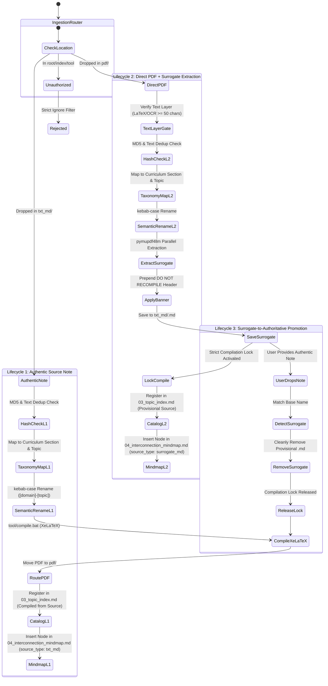

# Repository Management Skill (Universal & Portable Edition)

This skill defines the operational laws, lifecycle state machines, directory governance, and automated pipeline rules for managing an automated **Study Knowledge Hub & Notes Management Repository**.

Any AI agent entering this workspace—whether pre-existing or initialized in a brand-new directory—must execute strictly under this specification in coordination with the `karpathy-guidelines` skill.

---

## 1. Portable Workspace Architecture & Directory Layout

### 1.1 Dynamic Root Resolution
The workspace root is defined dynamically as `<WORKSPACE_ROOT>` (the project root where `manage.py`, `manage.bat`, and `README.md` reside). **NEVER hardcode absolute machine paths** (such as specific drive letters or user directories). All operational paths are resolved relative to `<WORKSPACE_ROOT>`.

### 1.2 Universal Directory Roles
```text
<WORKSPACE_ROOT>/
├── txt_md/     <-- INGESTION & TEXT: Authentic source notes & provisional search surrogates ONLY
├── pdf/        <-- PUBLISHED OUTPUT: Final compiled XeLaTeX PDFs and verified direct PDF imports
├── index/      <-- CONTROL PLANE: Internal AI-only machine-readable indexation & relational graph
│   ├── README.md              <-- Master control plane index and quick entry
│   ├── 00_syllabus_taxonomy.md <-- Formal curriculum breakdown, sub-topic inventory & coverage matrix
│   ├── 01_tool_usage.md       <-- Compiler usage, execution flags & bypass commands
│   ├── 02_directory_management.md <-- Governance, naming SOP, deduplication & lifecycle rules
│   ├── 03_topic_index.md      <-- Master document catalog, coverage dashboard & detail blocks
│   ├── 04_interconnection_mindmap.md <-- Semantic YAML knowledge graph & relational triples
│   └── 05_contributing_and_versioning.md <-- Architecture, line-change budget & cumulative ledger
├── md_skill/   <-- REUSABLE SKILLS VAULT: Portable skill blueprints & automated installer driver
│   ├── README.md              <-- Skill deployment instructions
│   ├── install.bat            <-- 1-click deployment driver copying blueprints to .agent/skills/
│   ├── SKILL.md               <-- Karpathy Guidelines skill blueprint
│   └── management_skill.md    <-- Repository Management skill blueprint (authoritative source)
├── tool/       <-- COMPILER ENGINE: Pandoc + XeLaTeX publishing toolchain (STRICTLY IMMUTABLE)
│   ├── compile.bat            <-- Windows compilation driver
│   ├── setup.bat              <-- Environment verification script
│   ├── config/                <-- LaTeX templates, Lua filters, and normalizers
│   └── documentation/         <-- Architecture and rendering specifications
├── manage.bat  <-- One-click automation batch driver (scan, process, audit-duplicates, coverage)
├── manage.py   <-- Master automation engine (mechanical operations, deduplication & catalog reconciler)
└── README.md   <-- User manual and quick-start guide
```

### 1.3 Immutable Boundaries & Core Safeguards
1. **The `tool/` Directory is Read-Only & Strictly Immutable**:
   - Never edit, modify, overwrite, append, or delete ANY file in `tool/` (`compile.bat`, `setup.bat`, Lua filters in `config/`, `custom.tex`, or documentation). Treat `tool/` as an external, frozen compiler engine.
2. **Strict Ingestion Source Isolation**:
   - Only files placed inside `txt_md/` are eligible for note compilation.
   - Only pre-compiled PDFs placed inside `pdf/` are eligible for direct PDF ingestion.
   - Any `.txt`, `.md`, or `.pdf` file found outside these two folders (e.g. in root, `index/`, `tool/`) is **strictly ignored**—do NOT index, rename, or compile it.
3. **Non-Destructive Source Content Policy**:
   - Never alter, rewrite, edit, or summarize substantive conceptual content in `txt_md/`. Original equations, explanations, derivations, and statements must remain untouched.
   - *Exception*: Syntax-only fixes (closing broken fences, escaping invalid LaTeX tokens) are permitted ONLY when compilation fails with a fatal error or upon explicit user request.
4. **AI-Only Control Plane Mandate**:
   - The entire `index/` directory is an internal AI control plane designed for machine parsing, retrieval, and relational reasoning (not human visual presentation). Do not insert human diagrams or decorative charts into `03_topic_index.md` or `04_interconnection_mindmap.md`. When the user asks for relationships or summaries, query the control plane and respond in conversational markdown.
5. **Search Isolation Mandate**:
   - `manage.py` is a mechanical executor, NOT a search engine. When the user asks to search, find topics, or trace relationships, **`manage.py` must NEVER be used**. The AI agent performs all searching directly using native reading tools.

---

## 2. Systematic Operational Protocol: Step-by-Step Order of Operations

When operating in this repository—whether starting a fresh session or processing new inputs—the AI agent must follow this exact sequential lifecycle:

### Phase 0: Repository Discovery & Orientation (Onboarding / Entry Protocol)
Before touching any files or executing commands:
1. **Locate Workspace Root**: Identify the working directory containing `manage.py` and `manage.bat`.
2. **Inspect Git Status**: Run `git status` to verify clean state, check for uncommitted changes or untracked user inputs.
3. **Verify Prerequisites**: Confirm that Python 3.10+, Pandoc, and XeLaTeX (`xelatex`) are accessible.
4. **Proactive Repository Audit (`manage.bat scan`)**:
   - Run `manage.bat scan` to reconcile physical files in `txt_md/` and `pdf/` against `index/03_topic_index.md`.
   - Identify whether any newly added notes or PDFs are awaiting ingestion.
5. **Deduplication Audit (`manage.bat audit-duplicates`)**:
   - Verify zero duplicate content hashes exist across the library.

---

### Phase 1: Ingestion Lifecycles & State Machine



#### Lifecycle 1: Processing Authentic Source Notes (`txt_md/` -> `pdf/`)
1. **Analyze Content**: Read the note to determine Domain, Core Concepts, Prerequisites, and dense Summary.
2. **Deduplication Check**: Compare MD5 hash and normalized text against all files in `txt_md/`. If identical, halt and inform user.
3. **Taxonomy Classification**: Map document to its formal curriculum section (`SEC-XX`) and sub-topic unit based on `index/00_syllabus_taxonomy.md`.
4. **Semantic Renaming**: Rename to `kebab-case` (`[domain]-[topic].[ext]`).
5. **Headless Compilation**:
   - Run via `(echo Y & echo.) | tool\compile.bat txt_md\<filename>.md` with `BypassSandbox: true`.
   - Verify that `<filename>.pdf` was successfully created.
6. **PDF Routing**: Move `<filename>.pdf` from `txt_md/` to `pdf/`.
7. **Control Plane Registration**:
   - In `index/03_topic_index.md`: Add/update table row with `Section`, `Syllabus Topic`, and status `Compiled from Source`. Add detail history block.
   - In `index/04_interconnection_mindmap.md`: Insert node with `section:`, `syllabus_topic:`, `source_type: txt_md`, `source_note: <filename>.<ext>`, and connect relational edges.

#### Lifecycle 2: Ingesting Direct Pre-Compiled PDFs (`pdf/` -> `txt_md/`)
1. **Text Layer Quality Gate**: Verify digital text layer density ($\ge 50$ clean characters). Reject scanned bitmap PDFs without OCR.
2. **Deduplication Check**: Compare MD5 hash against existing PDFs in `pdf/`.
3. **Taxonomy Classification**: Determine primary curriculum section and sub-topic unit.
4. **Semantic Renaming**: Rename PDF in `pdf/` to semantic `kebab-case`.
5. **Surrogate Extraction (`pymupdf4llm`)**:
   - Extract structured Markdown into `txt_md/<basename>.md`.
   - Prepend mandatory safety banner:
     ```markdown
     <!-- ===================================================================== -->
     <!-- AUTO-GENERATED SURROGATE SOURCE (FOR SEARCH & CATALOGING ONLY)       -->
     <!-- Source PDF: <basename>.pdf                                            -->
     <!-- Status: PROVISIONAL SURROGATE (DO NOT RECOMPILE)                      -->
     <!-- Purpose: Instant full-text search, AI context retrieval & knowledge graph mapping. -->
     <!-- Note: Will be automatically replaced when an authentic manual source note is provided. -->
     <!-- ===================================================================== -->
     ```
6. **Strict Compilation Lock**: `manage.py` and compilation drivers must halt with exit code 1 if asked to compile a surrogate note.
7. **Control Plane Registration**:
   - `03_topic_index.md`: Register with status `Provisional Source (Auto-extracted)`.
   - `04_interconnection_mindmap.md`: Insert node with `source_type: surrogate_md`, `source_note: <basename>.md`.

#### Lifecycle 3: Promoting Surrogate to Authoritative Source
1. **Detect Trigger**: User drops an authentic `.txt` or `.md` note matching an existing surrogate base name.
2. **Remove Surrogate**: Safely delete the provisional `<basename>.md` file.
3. **Ingest Authentic Note**: Ingest, rename, and release the compilation lock.
4. **Compile Definitive PDF**: Compile via `tool/compile.bat` and overwrite `pdf/<basename>.pdf`.
5. **Promote Control Plane Status**:
   - `03_topic_index.md`: Promote status to `Compiled from Source`.
   - `04_interconnection_mindmap.md`: Promote node to `source_type: txt_md`.

---

## 3. Option 1: Virtual Curriculum Taxonomy Architecture

1. **Physical Storage Invariance**:
   - The physical directories `txt_md/` and `pdf/` **MUST ALWAYS REMAIN FLAT**.
   - **Never create physical section sub-directories** (e.g. `txt_md/SEC-07/` or `pdf/SEC-01/`). Physical sub-directories break relative Pandoc compilation paths, LaTeX font/filter loaders, and Git history.
2. **Virtual Control Plane Mapping**:
   - All hierarchical taxonomy (Sections, Topics, Units) is maintained virtually inside the `index/` control plane:
     - `index/00_syllabus_taxonomy.md`: Defines curriculum sections, lists all sub-topic units, and tracks coverage percentages.
     - `index/03_topic_index.md`: Master table columns `Section` (`SEC-01` to `SEC-11`) and `Syllabus Topic`, plus detail blocks.
     - `index/04_interconnection_mindmap.md`: YAML node fields `section:` and `syllabus_topic:`.
3. **Real-Time Coverage Auditing**:
   - Run `cmd /c "manage.bat coverage"` (or `python manage.py coverage`) to generate a complete syllabus coverage audit, note counts, and curriculum gap alerts.

---

## 4. Automation Engine Scope & Boundaries (`manage.py` / `manage.bat`)

### ✅ Permitted Mechanical Engine Capabilities:
1. **Mechanical File Operations**: Renaming, moving compiled PDFs to `pdf/`, cleaning provisional surrogates upon replacement.
2. **Headless Compilation Driver**: Running `tool/compile.bat` non-interactively with piped stdin.
3. **Compilation Interlock**: Rejecting compilation for any file containing `DO NOT RECOMPILE` / `AUTO-GENERATED SURROGATE`.
4. **Atomic Control Plane Updates**: Appending/updating rows and detail blocks in `03_topic_index.md` and nodes/edges in `04_interconnection_mindmap.md`.
5. **Deduplication & Coverage Audits**:
   - `manage.bat scan`: Verifying unindexed files and counting authentic source notes vs provisional surrogates.
   - `manage.bat audit-duplicates`: Checking whole-repository MD5 hashes and normalized body text similarity.
   - `manage.bat remove-doc`: Consolidating and removing duplicate documents atomically.
   - `manage.bat coverage`: Computing real-time curriculum coverage metrics and gap alerts.
6. **Zero-Permission Execution**: Staging instructions in `.pending.json` and invoking static `cmd /c "manage.bat process"`.

### ❌ Strictly Prohibited Engine Actions:
1. **NEVER modify or touch `tool/`**.
2. **NEVER alter substantive text inside `txt_md/`**.
3. **NEVER use regex/heuristics to invent titles or topic relationships** (the AI must always read and analyze first).
4. **NEVER touch files outside `txt_md/` and `pdf/`**.
5. **NEVER USE `manage.py` FOR SEARCHING OR USER QUERIES**.

---

## 5. Three-Stage Search & Retrieval Protocol (AI Execution Only)

When the user asks to search, find topics, explore conceptual connections, or review notes:
1. **Never Invoke `manage.py` for Search**: Searching is purely an AI reading, reasoning, and synthesis task.
2. **Sequential Search Execution**:
   - **Stage 1 (Control Plane Lookup)**: Query `index/03_topic_index.md` (Master Table + detail blocks) and `index/04_interconnection_mindmap.md` (YAML nodes and relational triples) to identify candidate `DOC-XXX` IDs, domains, syllabus topics, and prerequisites.
   - **Stage 2 (Full-Text Scan across `txt_md/`)**: Search across the plaintext `.md`/`.txt` files in `txt_md/` (covering 100% of notes thanks to surrogate extraction).
   - **Stage 3 (Deep Read & Synthesis)**: Use `read_file` on focal notes to inspect exact equations, proofs, and definitions. Deliver a synthesized answer with KaTeX math and clickable links to both source note (`[note.md](file:///.../txt_md/note.md)`) and published PDF (`[note.pdf](file:///.../pdf/note.pdf)`).

---

## 6. Proactive Maintenance, Git Standards & 8-Document Audit Checklist

1. **Session Entry Check**: Proactively run `manage.bat scan` on session startup.
2. **Zero Redundancy**: If duplicates are detected, consolidate into a single document ID immediately.
3. **Git Hygiene**:
   - `.gitignore` must ignore `pdf/*` (except `pdf/.gitkeep`). Binary PDFs are never pushed.
   - All note text in `txt_md/` (authentic + surrogate) and index files in `index/` are tracked and pushed.
   - Never commit `.pending.json`, `tool/md2pdf_cache/`, `__pycache__/`, or scratch files.
4. **Mandated 8-Document Audit Checklist**:
   After any structural, workflow, or engine modification, audit and synchronize all 8 core documents:
   - `README.md` (Root user manual, quick start, workflow descriptions)
   - `index/README.md` (Master AI instructions, folder structure tree, operational rules)
   - `index/00_syllabus_taxonomy.md` (Curriculum breakdown, sub-topic inventory & coverage matrix)
   - `index/01_tool_usage.md` (Compiler flags, `manage.bat` command shapes, execution permissions)
   - `index/02_directory_management.md` (Taxonomic rules, kebab-case schemas, deduplication checks)
   - `index/03_topic_index.md` (Machine-readable inventory, coverage dashboard, detail history blocks)
   - `index/04_interconnection_mindmap.md` (YAML knowledge graph, total_nodes, total_edges, triples)
   - `index/05_contributing_and_versioning.md` (Working rules, lifecycle state machine, change ledger)

---

## 7. Portable Bootstrapping Guide: Deploying in a Fresh Directory

If this skill is introduced into a new, uninitialized folder:
1. **Initialize Directory Skeleton**: Create `txt_md/`, `pdf/`, `index/`, `md_skill/`, and place `manage.py` and `manage.bat` in the root.
2. **Install Skills**: Run `md_skill/install.bat` to deploy blueprints into `.agent/skills/`.
3. **Link Compiler Tool**: Ensure `tool/` is present as an immutable submodule or standalone directory.
4. **Initialize Control Plane**:
   - Create `index/00_syllabus_taxonomy.md` defining the subject curriculum.
   - Create `index/03_topic_index.md` with the Master Table header.
   - Create `index/04_interconnection_mindmap.md` with baseline YAML header (`total_nodes: 0`, `total_edges: 0`).
5. **Run Baseline Scan**: Execute `manage.bat scan` to verify clean initialization.
