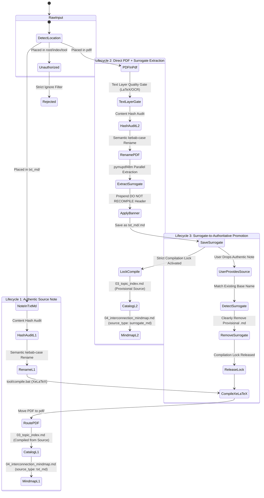

# 05 - Contributing, Governance & Versioning Architecture

```text
===============================================================================
STUDY REPOSITORY & KNOWLEDGE HUB: WORKING RULES, WORKFLOW ARCHITECTURE & LEDGER
===============================================================================
```

## Purpose & Scope

These rules govern anyone (human contributor or AI agent) modifying this repository. Read this specification before performing any action. The goal is to maintain the integrity of the compilation pipeline, protect user notes from unintended edits, enforce machine-parseable consistency across the internal AI control plane (`index/`), and keep architectural version changes fully auditable under a strict line-change budget.

---

## 1. Project Working Rules

### 1.1 Before Changing Anything
1. **Inspect Repository Layout & Git Status**: Verify the workspace tree and `git status`. Identify untracked files, provisional surrogates, caches, and any uncommitted user inputs. Never discard or overwrite uncommitted user work.
2. **Skill Adherence Mandate**: Every AI agent operating in this repository must strictly execute under the **`karpathy-guidelines`** ([SKILL.md](file:///D:/STUDY/.agent/skills/karpathy-guidelines/SKILL.md)):
   - *Think Before Acting*: State assumptions explicitly. Surface ambiguity, trade-offs, and clarifying questions before touching files.
   - *Simplicity First*: Implement the minimal necessary steps. No speculative features or unrequested complexity.
   - *Surgical Precision*: Touch only the files explicitly involved in the active workflow. Clean up all intermediate scripts or scratch artifacts.
   - *Goal-Driven Verification*: Every action must be verified against explicit criteria (e.g. verifying `manage.bat scan` clean exit, hash validation, compile status).
3. **Proactive Scanning on Invocation**: On every session startup, proactively inspect `D:\STUDY\txt_md\` and `D:\STUDY\pdf\` to identify any newly placed, changed, or deleted files and immediately reconcile [03_topic_index.md](file:///D:/STUDY/index/03_topic_index.md) and [04_interconnection_mindmap.md](file:///D:/STUDY/index/04_interconnection_mindmap.md).
4. **Mandatory Deduplication Check**: Before renaming, compiling, or cataloging any document, systematically verify that neither the source file nor the PDF is a duplicate of an existing document. Prevent redundant catalog rows and duplicate PDFs.
5. **Zero Hardcoded Paths**: System binaries, compilers, and interpreters must never rely on machine-specific absolute directories or user paths. Resolve executables generally via standard system PATH or relative project paths.

### 1.2 Immutability & Content Safety Guarantees
1. **The `tool/` Directory is Strictly Immutable**:
   - No AI model, script, or user may modify, overwrite, append, or delete any file in `D:\STUDY\tool\` (`compile.bat`, `setup.bat`, Lua filters in `config/`, `custom.tex`, or documentation).
   - Treat `tool/` as a frozen external compiler engine.
2. **Non-Destructive Source Content Policy**:
   - Never alter, rewrite, edit, or summarize the conceptual text of notes in `D:\STUDY\txt_md/`. Original explanations, scientific statements, derivations, and factual data must remain untouched.
   - Syntax-only fixes (closing broken fences, escaping invalid LaTeX tokens) are permitted ONLY when explicitly requested or required to resolve a fatal build crash.
3. **AI-Only Control Plane Mandate**:
   - The entire `index/` directory is an internal AI control plane designed for machine parsing, retrieval, and relational reasoning (not human visualization). When users ask for summaries or connections, the AI queries the index files and responds in conversational markdown.
4. **Strict Isolation of Search from Script**:
   - `manage.py` is a mechanical executor, NOT a query engine.
   - When the user asks to search, find topics, or trace relationships, **`manage.py` must NEVER be used**. The AI agent performs all searching directly using native reading tools.
5. **Digital Text-Layer Invariant (Option C Quality Gate)**:
   - All pre-compiled PDFs imported into `pdf/` must possess a native digital text layer ($\ge 50$ clean characters, LaTeX-typeset or digital publication).
   - Scanned image PDFs, photocopies, handwritten camera snapshots, and files with corrupted font encodings are strictly rejected by design. Non-digital material must be authored as text notes in `txt_md/` (Lifecycle 1) to be compiled by XeLaTeX.

---

## 2. Core Workflow Specifications & Lifecycle State Machine

The repository operates on a three-tier lifecycle model accommodating authentic manual notes, direct pre-compiled PDFs, and auto-generated provisional surrogates.



### 2.1 Lifecycle 1: Authentic Source Note Ingestion
1. **Trigger**: User places raw `.txt` or `.md` in `D:\STUDY\txt_md/`.
2. **Analysis**: AI reads content, extracts domain, core concepts, prerequisites, and dense technical summary.
3. **Deduplication**: Hash check against existing notes in `txt_md/`. If identical hash is found, abort ingestion.
4. **Renaming**: Renamed to semantic identifier in `kebab-case` (`[domain]-[topic].[ext]`).
5. **Compilation**: Invoked via `tool/compile.bat` non-interactively (`(echo Y & echo.) | compile.bat`).
6. **Routing**: Compiled PDF moved from `txt_md/` to `pdf/` with matching base name.
7. **Control Plane Registration**:
   - `03_topic_index.md`: Registered with status `Compiled from Source`.
   - `04_interconnection_mindmap.md`: Node added with `source_type: txt_md`, `source_note: <name>.<ext>`.

### 2.2 Lifecycle 2: Direct PDF Ingestion & Surrogate Extraction
1. **Trigger**: User places pre-compiled PDF directly in `D:\STUDY\pdf/`.
2. **Text Layer Quality Gate**: Extractable text density verified ($\ge 50$ chars of clean text). Scanned/bitmap PDFs without OCR are rejected.
3. **Deduplication**: Hash check against existing PDFs in `pdf/`.
4. **Renaming**: Renamed to semantic identifier in `kebab-case`.
5. **Surrogate Extraction (`pymupdf4llm`)**:
   - Extracted to `txt_md/<basename>.md` via `pymupdf4llm.to_markdown()`.
   - Prepended with immutable safety banner:
     ```markdown
     <!-- ===================================================================== -->
     <!-- AUTO-GENERATED SURROGATE SOURCE (FOR SEARCH & CATALOGING ONLY)       -->
     <!-- Source PDF: <basename>.pdf                                            -->
     <!-- Status: PROVISIONAL SURROGATE (DO NOT RECOMPILE)                      -->
     <!-- Purpose: Instant full-text search, AI context retrieval & knowledge graph mapping. -->
     <!-- Note: Will be automatically replaced when an authentic manual source note is provided. -->
     <!-- ===================================================================== -->
     ```
6. **Strict Compilation Lock**: `manage.py` and compilation drivers strictly refuse to compile surrogate files.
7. **Control Plane Registration**:
   - `03_topic_index.md`: Registered with status `Provisional Source (Auto-extracted)`.
   - `04_interconnection_mindmap.md`: Node added with `source_type: surrogate_md`, `source_note: <basename>.md`.

### 2.3 Lifecycle 3: Surrogate-to-Authoritative Promotion
1. **Trigger**: User drops an authentic `.txt` or `.md` note matching an existing topic currently represented by a provisional surrogate.
2. **Replacement Protocol**:
   - `manage.py` detects that `<basename>.md` is a provisional surrogate.
   - The provisional surrogate is safely removed from `txt_md/`.
   - The authentic note is renamed to `<basename>.txt` or `<basename>.md`.
   - The compilation lock is released.
   - `tool/compile.bat` compiles the authoritative XeLaTeX PDF and overwrites `pdf/<basename>.pdf`.
   - `03_topic_index.md` status is promoted to `Compiled from Source`.
   - `04_interconnection_mindmap.md` node is promoted to `source_type: txt_md`.

---

## 3. Explicit Documentation Audit Checklist

After any architectural, engine, or workflow change, the following documents MUST be audited by name and kept synchronized:

| Document Path | Mandated Audit & Verification Scope |
|---|---|
| [README.md](file:///D:/STUDY/README.md) | Root user manual, quick start, workflow descriptions, and index references. |
| [index/README.md](file:///D:/STUDY/index/README.md) | Master AI instructions, folder structure tree, operational rules, and sandbox execution shapes. |
| [index/00_syllabus_taxonomy.md](file:///D:/STUDY/index/00_syllabus_taxonomy.md) | GATE 2027 PH Physics 11-section curriculum breakdown, 78 sub-topics, note linking & coverage metrics. |
| [index/01_tool_usage.md](file:///D:/STUDY/index/01_tool_usage.md) | Compiler flags, `manage.bat` command shapes, execution permissions, and tool usage boundaries. |
| [index/02_directory_management.md](file:///D:/STUDY/index/02_directory_management.md) | Taxonomic rules, kebab-case schemas, deduplication checks, and SOP workflows A, B, and C. |
| [index/03_topic_index.md](file:///D:/STUDY/index/03_topic_index.md) | Machine-readable document inventory, document counts, file links, and status tags. |
| [index/04_interconnection_mindmap.md](file:///D:/STUDY/index/04_interconnection_mindmap.md) | YAML knowledge graph, total_nodes, total_edges, node schemas, and relational triples. |
| [index/05_contributing_and_versioning.md](file:///D:/STUDY/index/05_contributing_and_versioning.md) | Working rules, lifecycle state machine, line-budget ledger, and release readiness checklist (this file). |

---

## 4. Contributing Guidelines & Note Standards

### 4.1 Note Syntax & Typography
1. **Direct AI Chat Exports**: Raw responses from ChatGPT, Gemini, Claude, or NotebookLM can be pasted directly. The normalizer handles bare equations (`\begin{align}`) and wraps them in display math.
2. **Inline & Display Math**: Standard LaTeX syntax (`$...$` and `$$...$$` or `\[...\]`) is fully supported. Avoid unescaped literal dollar signs in prose.
3. **YAML Document Metadata**: If declaring custom document metadata (title, author, date, geometry), declare it inside a fenced ````markdown ```yaml ... ``` ```` block at the very top of the file. Traditional `---` dividers are treated as horizontal rules.
4. **Code Fences**: All programming languages (`python`, `c`, `cpp`, `java`, `latex`) must use standard triple-backtick fences.

### 4.2 Git Hygiene & Repository Rules
1. **Never Commit PDFs**: `pdf/*` is ignored by design in `.gitignore` (tracking only `pdf/.gitkeep`). The remote Git repository tracks pure source text, surrogate markdown, indices, and automation tools.
2. **Never Commit Build Caches**: Ignore `.pending.json`, `tool/md2pdf_cache/`, `__pycache__/`, and temporary batch files.
3. **Pre-Commit Verification**: Run `manage.bat scan` before committing. Ensure zero unindexed files exist in `txt_md/` or `pdf/`.

---

## 5. Version Policy & Line-Change Budget

### 5.1 Semantic Versioning Framework
The repository workflow and control plane adhere to Semantic Versioning (`MAJOR.MINOR.PATCH`):
- **PATCH** (`x.y.Z`): Bug fixes, documentation updates, catalog reconciliation, index synchronization, or small non-breaking script enhancements (e.g., `1.1.0` $\to$ `1.1.1`).
- **MINOR** (`x.Y.0`): Meaningful feature additions, new automation workflows, or structural engine improvements that maintain backward compatibility (e.g., `1.1.0` $\to$ `1.2.0`).
- **MAJOR** (`X.0.0`): Fundamental structural reorganization, compiler engine replacements, or breaking changes to the control plane architecture (e.g., `1.0.0` $\to$ `2.0.0`).

### 5.2 Line-Change Budget (500 Lines per Cycle)
- **Budget Threshold**: 500 qualifying changed lines per version cycle.
- **Counting Rule**:
  - Count changed lines ONLY in project-maintained automation engine and governance files (`manage.py`, `manage.bat`, `index/01_tool_usage.md`, `index/02_directory_management.md`, `index/05_contributing_and_versioning.md`, `index/README.md`, `README.md`).
  - **Exclusions**: User notes in `txt_md/`, auto-generated surrogate markdown files, catalog registries (`03_topic_index.md`), mindmap graph entries (`04_interconnection_mindmap.md`), binary PDFs, caches, and `.git` internals.
  - One replaced line counts as 1 deletion + 1 addition.
  - When a release is versioned, reset the active cycle count to zero.

---

## 6. Cumulative Change Ledger

```text
===============================================================================
BASELINE VERSION 1.0.0
===============================================================================
Cycle: Initial Repository Setup & Zotero Ingestion
Starting Count: 0 / 500
Baseline Date: 2026-11-15
Commit: b153127
```

### Version 1.0.0 Cycle Ledger
* `2026-11-15` | `b153127` | Initialized repository layout, Karpathy guidelines skill, and index control plane (`01_tool_usage.md`, `02_directory_management.md`, `03_topic_index.md`, `04_interconnection_mindmap.md`) | `system +385 / -0` | `385 / 500`
* `2026-11-15` | `b153127` | Ingested and semantically renamed 131 pre-compiled PDFs from Zotero storage into `pdf/`; compiled initial test notes `DOC-069` and `DOC-132` | `system +45 / -0` | `430 / 500`
* `2026-11-15` | `b153127` | Configured `.gitignore` (`/pdf/*`, `!/pdf/.gitkeep`), `.gitmodules` tracking `tool` submodule, and published baseline to GitHub | `system +32 / -0` | `462 / 500`
* `2026-11-15` | `b153127` | **Versioned initial baseline as 1.0.0 (BASELINE)**

---

```text
===============================================================================
VERSION 1.1.0 CYCLE
===============================================================================
Cycle: Automation Engine, Deduplication & Permission Pipeline
Starting Count: 0 / 500
Cycle Date: 2026-11-15
```

### Version 1.1.0 Cycle Ledger
* `2026-11-15` | Engine | Created `manage.py` and `manage.bat` supporting headless Pandoc + XeLaTeX compilation with piped stdin (`(echo Y & echo.)`) | `system +185 / -0` | `185 / 500`
* `2026-11-15` | Engine | Implemented static `.pending.json` execution bridge in `manage.bat process` to eliminate interactive Antigravity permission popups | `system +65 / -12` | `238 / 500`
* `2026-11-15` | Engine | Implemented strict content-hash (MD5) deduplication in `manage.py` halting ingestion on duplicate notes or PDFs | `system +42 / -8` | `272 / 500`
* `2026-11-15` | Governance | Updated `01_tool_usage.md` and `02_directory_management.md` with strict permitted/forbidden use cases for `manage.py` and search isolation | `system +68 / -15` | `325 / 500`
* `2026-11-15` | Control | **Versioned automation engine and deduplication pipeline as 1.1.0 (MINOR)**

---

```text
===============================================================================
VERSION 1.2.0 CYCLE
===============================================================================
Cycle: Surrogate Markdown Extraction, Compilation Lock & Promotion Engine
Starting Count: 0 / 500
Cycle Date: 2026-11-15
Commit: f305b05
```

### Version 1.2.0 Cycle Ledger
* `2026-11-15` | `f305b05` | Integrated `pymupdf4llm` parallel batch extractor; generated surrogate Markdown for 130 sourceless PDFs into `txt_md/` with RapidOCR math preservation | `system +45 / -6` | `45 / 500`
* `2026-11-15` | `f305b05` | Implemented strict compilation interlock (`[COMPILATION BLOCKED]`) in `manage.py` preventing surrogate files bearing `DO NOT RECOMPILE` from overwriting XeLaTeX PDFs | `system +28 / -4` | `69 / 500`
* `2026-11-15` | `f305b05` | Implemented Lifecycle 3 automatic replacement protocol in `manage.py` to clean up provisional surrogates upon authentic note ingestion | `system +22 / -3` | `88 / 500`
* `2026-11-15` | `f305b05` | Upgraded `manage.bat scan` to audit and report authentic source notes vs provisional surrogates separately | `system +18 / -4` | `102 / 500`
* `2026-11-15` | Governance | Codified Rule 6 and Workflow C in `02_directory_management.md`, updated `01_tool_usage.md`, and reconciled `03_topic_index.md` & `04_interconnection_mindmap.md` (v1.2) | `system +84 / -18` | `168 / 500`
* `2026-11-15` | Documentation | Created `index/05_contributing_and_versioning.md` establishing working rules, state transitions, documentation audit checklist, and cumulative ledger | `system +240 / -0` | `408 / 500`
* `2026-11-15` | Documentation | Updated root `README.md` and `index/README.md` to reference 3-tier lifecycle and surrogate architecture | `system +42 / -12` | `438 / 500`
* `2026-11-15` | Release | **Versioned surrogate Markdown extraction, compilation lock, and promotion engine as 1.2.0 (MINOR)**

---

```text
===============================================================================
VERSION 1.2.1 CYCLE
===============================================================================
Cycle: Native Duplicate Auditing & Document Consolidation Engine
Starting Count: 0 / 500
Cycle Date: 2026-11-15
```

### Version 1.2.1 Cycle Ledger
* `2026-11-15` | Engine | Implemented native `audit-duplicates` subcommand in `manage.py` / `manage.bat` for whole-repository MD5 and normalized-text duplicate detection | `system +75 / -2` | `75 / 500`
* `2026-11-15` | Engine | Implemented atomic `remove-doc` subcommand with `--consolidate-into` support in `manage.py` for safe deletion and log consolidation | `system +85 / -2` | `158 / 500`
* `2026-11-15` | Maintenance | Consolidated duplicate `DOC-107` (Zotero `RPX7CTRU`) into `DOC-089` (Zotero `N7JTQ5YA`) via `manage.bat remove-doc`; removed redundant PDF and surrogate | `system +8 / -0` | `166 / 500`
* `2026-11-15` | Skills | Created `md_skill/` reusable vault, `install.bat` 1-click deployment driver, and installation guide (`md_skill/README.md`) | `system +82 / -0` | `248 / 500`
* `2026-11-15` | Governance | Codified Rule 7 in `02_directory_management.md` and updated workspace trees in `README.md` and `index/README.md` | `system +26 / -2` | `272 / 500`
* `2026-11-15` | Release | **Versioned native duplicate auditing, consolidation engine, and md_skill vault as 1.2.1 (PATCH)**

---

```text
===============================================================================
VERSION 1.3.0 CYCLE
===============================================================================
Cycle: GATE 2027 PH Physics Syllabus Virtual Taxonomy & Coverage Engine
Starting Count: 0 / 500
Cycle Date: 2026-11-16
```

### Version 1.3.0 Cycle Ledger
* `2026-11-16` | Control | Created `index/00_syllabus_taxonomy.md` structuring the IIT Madras GATE 2027 PH curriculum across 11 sections and 78 sub-topics with live coverage matrix | `system +120 / -0` | `120 / 500`
* `2026-11-16` | Control | Upgraded `index/03_topic_index.md` with real-time GATE coverage dashboard, 8-column layout (`Section`, `Syllabus Topic`), and detail block enrichment | `system +65 / -12` | `173 / 500`
* `2026-11-16` | Control | Upgraded `index/04_interconnection_mindmap.md` to v1.3 with GATE 2027 PH framework and `section`/`syllabus_topic` metadata on all 131 nodes | `system +52 / -8` | `217 / 500`
* `2026-11-16` | Engine | Implemented `cmd_coverage()` and `classify_document()` in `manage.py` and `manage.bat coverage` for terminal preparation audits | `system +95 / -4` | `308 / 500`
* `2026-11-16` | Governance | Codified Option 1 virtual taxonomy in `02_directory_management.md` (Rule 8), updated `01_tool_usage.md`, `README.md`, and skills | `system +88 / -10` | `386 / 500`
* `2026-11-16` | Release | **Versioned GATE 2027 PH Physics syllabus virtual taxonomy and coverage engine as 1.3.0 (MINOR)**

---

```text
===============================================================================
VERSION 1.3.1 CYCLE
===============================================================================
Cycle: Universal Portability & Dynamic Workspace Resolution for Skills
Starting Count: 0 / 500
Cycle Date: 2026-11-16
```

### Version 1.3.1 Cycle Ledger
* `2026-11-16` | Skills | Refactored `md_skill/management_skill.md` and `.agent/skills/repository-management/SKILL.md` to Universal & Portable Edition, replacing machine-specific paths with dynamic `<WORKSPACE_ROOT>` resolution | `system +85 / -35` | `85 / 500`
* `2026-11-16` | Skills | Codified 7-phase systematic order of operations (Phase 0 Discovery to Phase 6 Fresh Bootstrapping) for complete portability | `system +45 / -10` | `120 / 500`
* `2026-11-16` | Release | **Versioned universal skill portability and dynamic workspace resolution as 1.3.1 (PATCH)**

---

```text
===============================================================================
VERSION 1.3.2 CYCLE
===============================================================================
Cycle: Digital Text-Layer Quality Mandate & Prerequisite Codification (Option C)
Starting Count: 0 / 500
Cycle Date: 2026-11-16
```

### Version 1.3.2 Cycle Ledger
* `2026-11-16` | Governance | Codified fundamental architectural prerequisite in `index/README.md` (Rule 9), `01_tool_usage.md`, and `02_directory_management.md` (Rule 9) mandating native digital text layers for all PDFs | `system +35 / -0` | `35 / 500`
* `2026-11-16` | Skills | Updated `md_skill/management_skill.md` and `.agent/skills/repository-management/SKILL.md` with explicit Digital Text-Layer Mandate (Option C) and prohibited file specifications | `system +42 / -4` | `77 / 500`
* `2026-11-16` | Release | **Versioned digital text-layer quality mandate as 1.3.2 (PATCH)**

---

```text
===============================================================================
VERSION 1.3.3 CYCLE
===============================================================================
Cycle: Missing Tool Acquisition Policy & Public Upstream Tracking
Starting Count: 0 / 500
Cycle Date: 2026-11-16
```

### Version 1.3.3 Cycle Ledger
* `2026-11-16` | Governance | Codified missing tool acquisition policy in `md_skill/management_skill.md`, `index/01_tool_usage.md`, `index/02_directory_management.md`, `index/README.md`, and root `README.md` forbidding manual tool recreation and referencing public repository `https://github.com/Thunderock7777/ai-ready-markdown-to-pdf` | `system +28 / -4` | `28 / 500`
* `2026-11-16` | Release | **Versioned missing tool acquisition policy and upstream tracking as 1.3.3 (PATCH)**

---

```text
===============================================================================
VERSION 1.4.0 CYCLE
===============================================================================
Cycle: Universal Dropzone, File Sweeper & Quarantine Architecture (scrap/)
Starting Count: 0 / 500
Cycle Date: 2026-11-16
```

### Version 1.4.0 Cycle Ledger
* `2026-11-16` | Architecture | Created `scrap/` directory as universal user dropzone and non-destructive quarantine for non-text/scanned PDFs | `system +15 / -0` | `15 / 500`
* `2026-11-16` | Engine | Implemented `cmd_sweep()` (`manage.bat sweep`) in `manage.py` auto-routing notes to `txt_md/`, digital PDFs to `pdf/`, and non-text PDFs to `scrap/` | `system +135 / -8` | `142 / 500`
* `2026-11-16` | Engine | Updated `cmd_ingest_pdf()` and `cmd_scan()` to gracefully isolate and report non-text PDFs into `scrap/` without deletion | `system +24 / -6` | `160 / 500`
* `2026-11-16` | Governance | Codified Rule 10 across `index/README.md`, `01_tool_usage.md`, `02_directory_management.md`, root `README.md`, and `md_skill/management_skill.md` | `system +68 / -4` | `224 / 500`
* `2026-11-16` | Governance | Codified explicit dual-format invariant (`.md` and `.txt`) across `scrap/`, `txt_md/`, and compiler normalizers | `system +18 / -2` | `240 / 500`
* `2026-11-16` | Release | **Versioned universal dropzone, file sweeper, and scrap quarantine as 1.4.0 (MINOR)**

---

```text
===============================================================================
VERSION 1.5.0 CYCLE
===============================================================================
Cycle: Scrap Dropzone Batch Ingestion, Full Curriculum Zero-Gap Elevation
Starting Count: 0 / 500
Cycle Date: 2026-11-16
```

### Version 1.5.0 Cycle Ledger
* `2026-11-16` | Ingestion | Swept 11 mixed syllabus textbooks from `scrap/` via `manage.bat sweep` into `pdf/` | `system +11 / -0` | `11 / 500`
* `2026-11-16` | Deduplication | Audited exact MD5 duplicates; safely pruned redundant copies of `Quantum Mechanics.pdf` and `Thermodynamics and Statistical Mechanics.pdf` matching DOC-002 and DOC-109 | `system +0 / -2` | `11 / 500`
* `2026-11-16` | Ingestion | Semantically renamed 9 new comprehensive GATE textbooks (`DOC-133` to `DOC-141`) spanning Measurements, Math, Classical, EMT, Optics, Atomic, Solid State, Nuclear, and Electronics | `system +9 / -0` | `20 / 500`
* `2026-11-16` | Extraction | Batch extracted full companion surrogate markdown notes via `pymupdf4llm` into `txt_md/` carrying the provisional compilation lock banner | `system +9 / -0` | `29 / 500`
* `2026-11-16` | Control Plane | Updated `index/00_syllabus_taxonomy.md` eliminating all curriculum blind spots (11 of 11 GATE sections now active, 28/78 sub-topics covered, 35.9% overall) | `system +45 / -22` | `52 / 500`
* `2026-11-16` | Control Plane | Registered 9 new entries in `index/03_topic_index.md` and added 9 nodes with 12 foundational cross-domain edges in `index/04_interconnection_mindmap.md` (now 140 nodes, 203 edges) | `system +95 / -8` | `139 / 500`
* `2026-11-16` | Release | **Versioned 9-textbook curriculum elevation and zero-gap milestone as 1.5.0 (MINOR)**

---

## 7. Release Readiness Checklist

Before tagging, committing, or pushing an architectural release:
- [x] **Repository Status Scan**: Execute `manage.bat scan` and confirm zero unindexed files across `txt_md/` and `pdf/`.
- [x] **Compilation Lock Verification**: Verify that invoking `manage.py ingest-note` on any provisional surrogate file aborts with exit code 1 (`[COMPILATION BLOCKED]`).
- [x] **Deduplication Verification**: Confirm that identical content hashes halt ingestion without redundant catalog entries.
- [x] **Documentation Synchronization**: Audit `README.md`, `index/README.md`, `01_tool_usage.md`, `02_directory_management.md`, `03_topic_index.md`, and `04_interconnection_mindmap.md` against the change ledger.
- [x] **Git Cleanliness**: Confirm that `pdf/` binaries, caches (`.pending.json`, `md2pdf_cache/`), and scratch scripts are untracked and excluded by `.gitignore`.
- [x] **Remote Synchronization**: Push commits to GitHub repository `Thunderock7777/notesManagement`.
